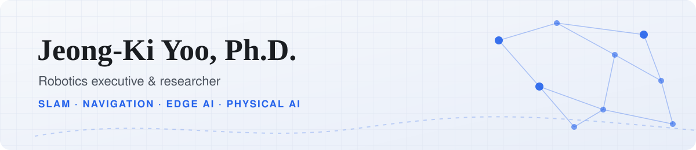
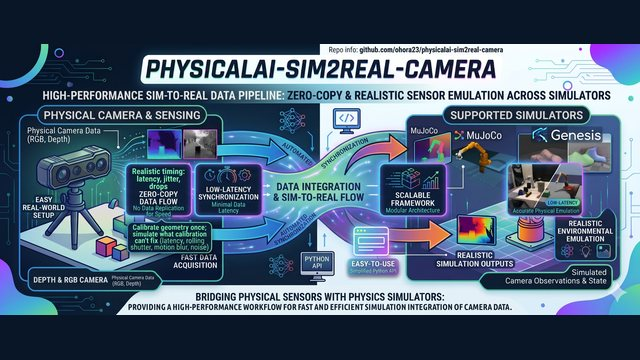
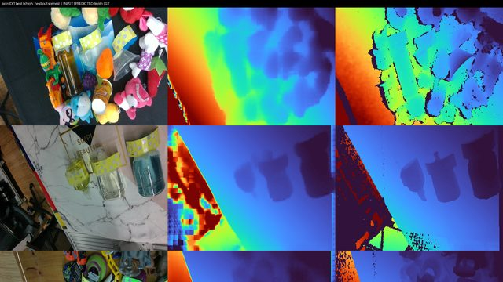
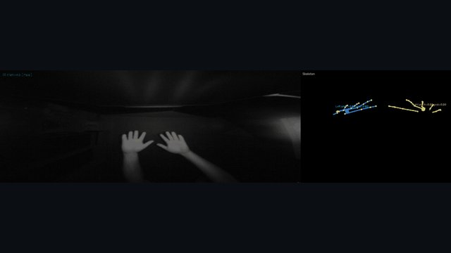
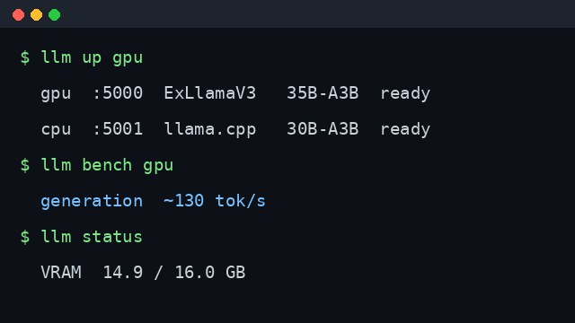

<picture>
  <source media="(prefers-color-scheme: dark)" srcset="assets/banner-dark.svg">
  
</picture>

  
  
  

I lead the engineers who make service and logistics robots **see, localize and move reliably**, and I stay close enough to the code to validate results on real robots. Director of Robotics Engineering at [Bear Robotics](https://www.bearrobotics.ai/) since 2024, based in Seoul; previously an assistant professor at Daejeon University and a senior engineer at Samsung Electronics.

<table>
  <tr>
    <td align="center" width="25%"><h3>6,000+</h3>robots built under my leadership</td>
    <td align="center" width="25%"><h3>5</h3>robots taken to mass production</td>
    <td align="center" width="25%"><h3>25×</h3>fewer localization failures with visual SLAM</td>
    <td align="center" width="25%"><h3>6 · 14</h3>journal papers · US/KR patents</td>
  </tr>
</table>

## 🛠️ Selected projects

<table>
<tr>
<td width="50%" valign="top">

<h3><a href="https://github.com/ohora23/Axon_SDK_for_PhysicalAI">axon</a></h3>

Zero-copy data transport for Physical AI along the sensor → accelerator → real-time control path. <b>7–19×</b> lower cross-process GPU latency than ROS 2.

C++ · Apache-2.0 · <a href="https://ohora23.github.io/Axon_SDK_for_PhysicalAI/">project page →</a>

</td>
<td width="50%" valign="top">

<h3><a href="https://github.com/ohora23/physicalai-sim2real-camera">PhysicalAI Sim2Real Camera</a></h3>

Makes MuJoCo and Genesis cameras behave like the robot's real one: distortion, noise, motion blur, rolling shutter, depth artefacts, latency and drops, fitted from real captures. ~0.3 ms per frame on the GPU path.

Python · Apache-2.0 · <a href="https://github.com/ohora23/physicalai-sim2real-camera">code →</a>

</td>
</tr>
<tr>
<td width="50%" valign="top">

<h3><a href="https://github.com/ohora23/edge-pointdit-regression-distillation">Edge-PointDiT</a></h3>

Transparent-object depth on a 2-TOPS RK3588 NPU: PointDiT reproduction retargeted from diffusion to regression, fp16 bit-exact with PyTorch.

Python · Apache-2.0 · <a href="https://ohora23.github.io/edge-pointdit-regression-distillation/">project page →</a>

</td>
<td width="50%" valign="top">

<h3><a href="https://github.com/ohora23/memgarden">MemGarden</a></h3>

Long-term memory for AI coding agents: local-LLM fact extraction and hybrid recall in one Rust binary on one SQLite file.

Rust · MIT · <a href="https://ohora23.github.io/memgarden/">project page →</a>

</td>
</tr>
<tr>
<td width="50%" valign="top">

<h3><a href="https://github.com/ohora23/leap-motion-linux-revival">Leap Motion Linux Revival Kit</a></h3>

The original Leap Motion Controller back on modern Linux after Ultraleap shut down: archived packages, a udev fix, a live visualizer.

Shell · Python · MIT · <a href="https://ohora23.github.io/leap-motion-linux-revival/">project page →</a>

</td>
<td width="50%" valign="top">

<h3><a href="https://github.com/ohora23/local-llm-toolkit">Local LLM Toolkit</a></h3>

Several local LLMs on one 16 GB GPU: one CLI and a native GUI, serving profiles, benchmarks and coding-eval harnesses.

Shell · Rust · MIT · <a href="https://ohora23.github.io/local-llm-toolkit/">project page →</a>

</td>
</tr>
</table>

## 🔭 Focus

  
  
  
  
  
  

  
  
  
  
  
  
  
  

Company figures are relative or counts only. More on the <a href="https://ohora23.github.io">portfolio site</a>.
